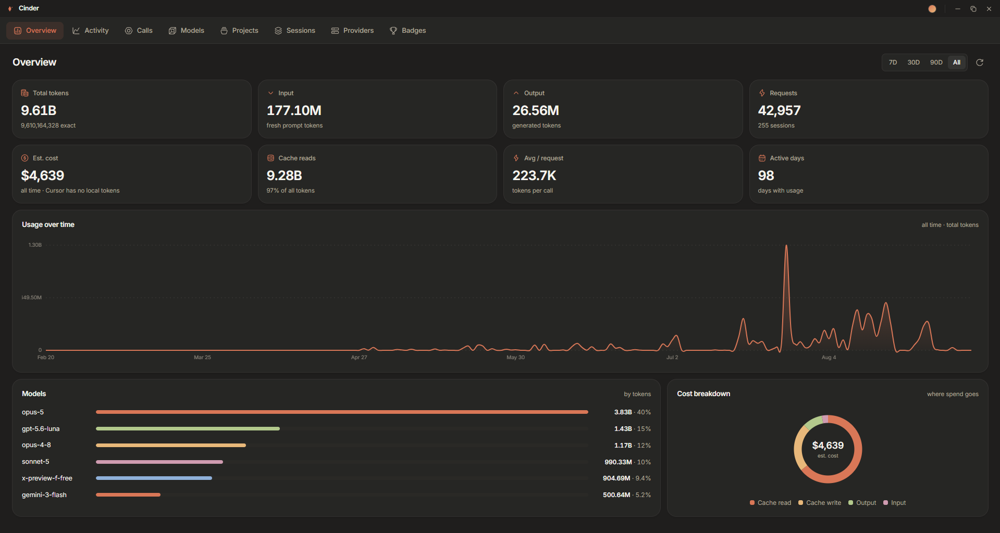

# Cinder

Desktop usage tracking for coding tools. See tokens, costs, sessions and account limits across your local tools.



## Download

Get the installers from the [latest release](https://github.com/mydd7/cinder/releases/latest).

| Platform             | Download                     |
| -------------------- | ---------------------------- |
| Windows x64          | `Cinder-Setup-<version>.exe` |
| macOS, Apple silicon | `Cinder-<version>-arm64.dmg` |
| macOS, Intel         | `Cinder-<version>-x64.dmg`   |

Installers are built by GitHub Actions. Windows installers are unsigned. macOS apps are ad-hoc signed and are not notarized.

On macOS, copy Cinder to Applications. If Gatekeeper blocks it, you can remove the download quarantine after checking the release's SHA-256 checksum:

```bash
xattr -dr com.apple.quarantine /Applications/Cinder.app
```

## Features

- Usage by tool, model, project and session, with hourly charts for Today.
- Costs, cache usage, speed premiums and custom model prices.
- Account quotas, reset times and available reset credits.
- Tool calls, MCP servers, skills and CSV exports.
- Fifteen themes with light, dark and system modes.

Cinder reads saved history from 19 tools, including Claude, Codex, Cursor, OpenCode and Grok. See [supported sources](docs/sources.md) for the full list.

History stays on your computer. Opening Limits or loading Cursor billing data contacts the provider using its existing login. Cost estimates are separate from subscription invoices.

## Development

Use Node.js 24 or newer.

```sh
npm ci
npm run dev
```

## Documentation

- [Usage and pricing](docs/usage.md)
- [Account limits](docs/limits.md)
- [Themes](docs/appearance.md)
- [Source paths and formats](docs/sources.md)
- [Architecture](docs/architecture.md)
- [Development](CONTRIBUTING.md)
- [Tests](docs/testing.md)
- [Releases](docs/releases.md)

[MIT](LICENSE).
